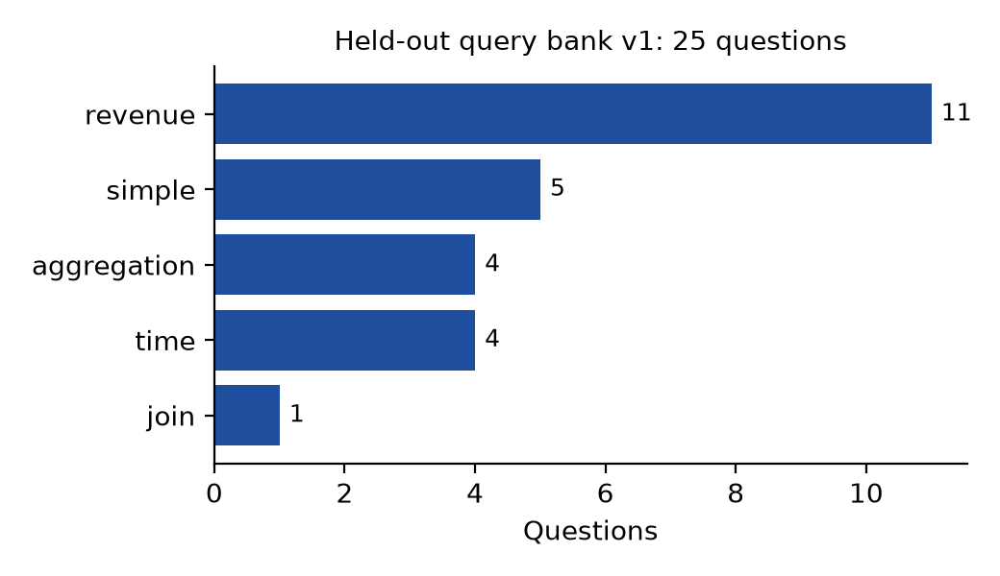

```{=typst}
#show <refs>: set par(hanging-indent: 0.5in, first-line-indent: 0pt, justify: false)
#set text(hyphenate: false)
#set bibliography(title: "References")
#show cite: set text(fill: rgb("#1f4e9e"))
#show bibliography: set par(justify: false)
// Three-rule tables (top, below header, bottom) and bold "Figure N" / "Table N" labels
#set table.hline(stroke: 0.6pt)
#show table: it => box(stroke: (top: 1pt, bottom: 1pt), it)
#show figure.caption: it => context [#strong[#it.supplement~#it.counter.display(it.numbering)#it.separator]#it.body]
#show table: set par(justify: false)
#show heading.where(level: 1): it => block(above: 1.2em, below: 0.6em)[
  #set text(fill: rgb("#1f4e9e"), size: 14pt, weight: "bold")
  #it
]
#show heading.where(level: 2): set text(fill: rgb("#2d2d2d"), size: 11.5pt)
#let glance(body) = block(fill: rgb("#eef3fb"), stroke: (left: 3pt + rgb("#1f4e9e")), inset: 10pt, radius: 2pt, width: 100%, body)
// Header: red title, subtitle, author, repository link
#align(center)[
  #set par(justify: false)
  #text(size: 17pt, weight: "bold", fill: rgb("#b91c1c"))[Analytics Copilot]
  #v(0.5em)
  #text(size: 12pt, weight: "bold")[Safe, conversational text-to-SQL with schema RAG, charts, commentary and a regression harness]
  #v(0.9em)
  #text(size: 11pt)[Reagan Kesseku, Ph.D.]
  #linebreak()
  #text(size: 10pt)[#link("https://github.com/rkesseku/analytics-copilot")[github.com/rkesseku/analytics-copilot]]
  #v(0.45em)
  #text(size: 9.5pt)[#emph[Keywords:] text-to-SQL, retrieval-augmented generation, LLM evaluation, SQL safety, Databricks]
]
#v(0.5em)
```

```{=typst}
#glance[
*At a glance* \
*Problem:* Business users have far more data questions than analysts can answer. A naive "LLM writes SQL, run it" pipeline is unsafe, and nobody measures how accurate it is. \
*What I built:* A copilot that turns a question in plain English into validated SQL, runs it, charts the result and writes a short commentary. A regression harness scores the copilot on a held-out query bank. \
*Headline result:* I verified the safety layer and harness offline. All 104 tests pass, all 25 gold queries execute on the seeded demo database, and unsafe SQL (DROP, DELETE, UPDATE, tables not on the allow list) is rejected before it reaches the database. *There is no accuracy figure for a live LLM yet.* That run needs a model API key and has not been done. \
*Stack:* Python, sqlglot, DuckDB, Databricks SQL adapter, Groq LLM client, Pydantic, matplotlib, pytest. \
*Repo:* #link("https://github.com/rkesseku/analytics-copilot")[github.com/rkesseku/analytics-copilot]
]
```

# The problem

Most organisations have many more data questions than analysts to answer them. "Text-to-SQL" tools promise to close that gap by letting anyone ask in plain English, but connecting a language model straight to a database creates two serious risks. The first is *safety*: a model (or a prompt injection attack [@greshake2023]) could emit a `DROP TABLE` or read a table it should not see. The second is *trust*. A query that runs is not always a query that is right. Without a measured accuracy number, nobody can tell whether a change to the model or prompt made things better or worse.

This project is a small, complete reference for building such a tool responsibly. It answers a question end to end (SQL, result table, chart, written summary), places a validator between the model and the database, and ships the tooling needed to track accuracy over time. It runs on an in-memory DuckDB demo database by default, so anyone can try it without infrastructure.

## What the user gets

For a question such as "What are the top 3 product categories by revenue for delivered orders?", the CLI returns the generated SQL with the tables used, a confidence score and rationale, the result rows, an optional PNG chart (`--chart`), and a short summary with caveats, written for an executive reader. The README demo shows this output on the seeded data.

# Approach

## Architecture

{#fig-arch width=100%}

The pipeline is a thin facade (`AnalyticsCopilot.ask`) over five replaceable parts. The model, retriever and database each sit behind a `Protocol` (`LLMClient`, `SchemaRetriever`, `Backend`), so tests inject fakes and run with no network, and a different model, retriever or database can be swapped in without touching the rest.

1. *Schema RAG.* Following retrieval-augmented generation [@lewis2020rag], the retriever finds the tables relevant to the question and formats their business descriptions for the prompt.
2. *Text-to-SQL.* The model returns structured output (SQL, tables used, confidence, rationale), parsed with Pydantic.
3. *Validate.* sqlglot parses the SQL in the active backend's dialect and applies three checks (below).
4. *Execute.* Only validated SQL reaches the backend, with a row limit added if the query has none.
5. *Present.* `viz.py` picks a chart type from the shape of the result, and a second model call writes the commentary.

# Design decisions

## The validator is the trusted boundary

Three layers run on every statement. First, sqlglot parses it, and invalid SQL is rejected. Second, the statement must be a `SELECT` at the top level, and any nested mutation node is rejected. Third, every referenced table is checked against an allow list (`customers`, `products`, `orders`, `order_items`), with CTE names treated as virtual tables. A `LIMIT 1000` is added when absent. I chose a parser-based check over regular expressions or prompt instructions because formatting tricks cannot get around a parsed syntax tree, and the check does not depend on the model behaving well.

{#fig-val width=88%}

One quirk is worth stating plainly. The multi-statement example is blocked, but sqlglot reports it as "got BLOCK" rather than as an error about stacked statements. The decision (reject) is right, though the message is not especially friendly.

## Hand-written schema metadata

Table and column descriptions carry business meaning that introspection cannot supply (for example, `unit_price` on an order line is the price at time of order, not the current list price). The retriever matches keywords, with weights on table names, column names, example values and descriptions. The demo schema has four tables, and the retriever returns all four for every question I checked (the default `top_k` is 4). Retrieval is therefore in place but does no real selection yet. It will matter once the schema is large, which is why it sits behind a `SchemaRetriever` protocol, ready to be replaced by an embedding-based retriever.

## Pluggable backends and structured outputs

A small `Backend` protocol separates the pipeline from the engine. DuckDB is the default. A Databricks SQL Warehouse adapter (optional extra, `DATABRICKS_*` environment variables, Unity Catalog introspection via `information_schema`) is selected with `--backend databricks`. The validator parses in the backend's dialect. Both LLM calls use constrained, validated outputs, and the parser tolerates markdown fences.

# Results and evaluation

## How accuracy is measured

The harness (`python -m analytics_copilot.evals`) runs the copilot over a versioned query bank and scores two things. *Execution accuracy* compares the result set of the generated SQL with that of the gold SQL, ignoring row order and column names and using a numeric tolerance. A *commentary score* comes from an LLM judge [@zheng2023judge] that rates faithfulness, relevance and clarity from 1 to 5 against the actual result rows. The mean rating is normalised to the range 0 to 1. The harness writes JSON and Markdown reports and returns a nonzero exit code when accuracy falls below `--min-accuracy`, so it can gate CI.

::: {layout-ncol=2}
{#fig-bank}

{#fig-viz}
:::

## What I verified offline

I ran the following for this brief. None of it needs a model key.

| Check | Result |
|--------------------------------------------------|--------------------------------------------------|
| Test suite (`python -m pytest -q`) | 104 passed |
| Query bank | 25 questions: revenue 11, simple 5, aggregation 4, time 4, join 1 |
| Gold SQL on seeded demo DB (seed 42, anchor date 2026-05-22) | 25 of 25 execute |
| Demo data size | 10 customers, 15 products, 120 orders, 296 order items |
| Unsafe SQL (DROP, DELETE, UPDATE, off-list table, no table) | 7 of 7 blocked |
| Chart from a real result | line (12 monthly rows) and bar (top 3 categories) rendered |

: Offline verification. {#tbl-results}

*Not measured:* execution accuracy and commentary score of a live model on the 25 questions. The README states that the harness is tested with stub LLM clients, and the CI job runs the live evaluation only if a `GROQ_API_KEY` secret is configured. I make no claim about how well any model does on the bank. The bank is also skewed (revenue questions are 11 of 25 and only one question focuses on joins), so a future score would say more about revenue queries than about joins.

# What this demonstrates

- *Putting safety first in LLM engineering.* The trust boundary is a SQL parser with concrete, demonstrated rejections. It does not rely on prompts.
- *Measurement discipline.* A held-out query bank with gold SQL, result comparison that ignores row order, and an LLM judge, all built before any accuracy claim.
- *Clean architecture.* Seams defined by protocols, structured outputs and a backend abstraction that already supports two engines.
- *Testing.* There are 104 tests. The end-to-end pipeline tests use fake LLM clients, so CI needs no network or keys.

# Limitations and next steps

- There is no recorded accuracy baseline from a live model. The first step is to run the harness with a model key and publish the report.
- The Databricks adapter has unit tests against a fake connection only and has not been validated on a live workspace. Nothing is seeded there, and the model still sees the demo metadata.
- Demo data is tiny and synthetic (10 customers), so results say little about scale or messy real schemas.
- A schema with four tables does not exercise keyword retrieval. An embedding-based retriever is on the roadmap.
- There is no self-correction loop. If generated SQL fails to execute, the error is not fed back to the model.
- Token and latency accounting is not yet plumbed through the LLM client (the pipeline reports 0).
- The validator restricts statement types and tables but does not limit query cost beyond the default row limit.
- Only Groq is supported as a model provider. A Streamlit UI and more providers are listed as future work.

{#fig-bar width=55%}

# How to run it

```bash
pip install -e ".[dev]"
cp .env.example .env          # add GROQ_API_KEY for live use
python -m pytest -q           # offline, no key needed
python -m analytics_copilot.cli "Top 3 categories by revenue" --chart out.png
python -m analytics_copilot.cli --interactive
python -m analytics_copilot.evals --min-accuracy 0.8      # needs a key
python -m analytics_copilot.evals --no-judge --limit 5    # quick run
python docs/brief/make_figures.py                         # rebuild figures
```

# References {.unnumbered}

::: {#refs}
:::
