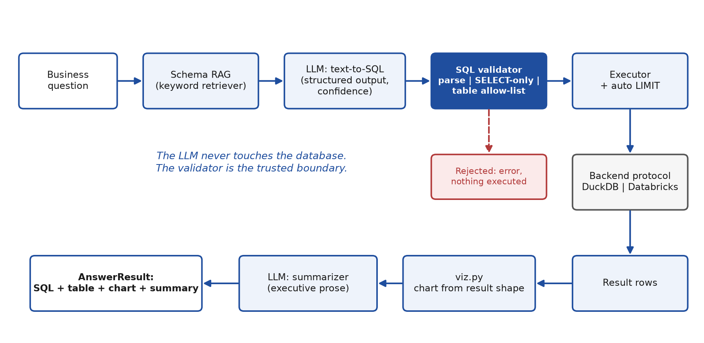

```{=typst}
#set text(hyphenate: false)
// Three-rule tables (top, below header, bottom) and bold "Figure N" / "Table N" labels
#set table.hline(stroke: 0.6pt)
#show table: it => box(stroke: (top: 1pt, bottom: 1pt), it)
#show figure.caption: it => context [#strong[#it.supplement~#it.counter.display(it.numbering)#it.separator]#it.body]
#show table: set par(justify: false)
#show heading.where(level: 1): it => block(above: 1.2em, below: 0.6em)[
  #set text(fill: rgb("#1f4e9e"), size: 14pt, weight: "bold")
  #it
]
#show heading.where(level: 2): set text(fill: rgb("#2d2d2d"), size: 11.5pt)
#let glance(body) = block(fill: rgb("#eef3fb"), stroke: (left: 3pt + rgb("#1f4e9e")), inset: 10pt, radius: 2pt, width: 100%, body)
// Header: red title, subtitle, author, repository link
#align(center)[
  #text(size: 17pt, weight: "bold", fill: rgb("#b91c1c"))[Analytics Copilot]
  #v(0.5em)
  #text(size: 12pt, weight: "bold")[Safe, conversational text-to-SQL with schema RAG, charts, commentary and a regression harness]
  #v(0.9em)
  #text(size: 11pt)[Reagan Kesseku, Ph.D.]
  #linebreak()
  #text(size: 10pt)[#link("https://github.com/rkesseku/analytics-copilot")[github.com/rkesseku/analytics-copilot]]
]
#v(0.5em)
```

```{=typst}
#glance[
*At a glance* \
*Problem:* Business users have far more data questions than analysts can answer, and a naive "LLM writes SQL, run it" pipeline is both unsafe and unmeasured. \
*What I built:* A copilot that turns a plain-English question into validated SQL, executes it, charts the result and writes a short commentary, plus a regression harness that scores it on a held-out query bank. \
*Headline result:* The safety layer and harness are verified offline: 104 of 104 tests pass, all 25 gold queries execute on the seeded demo database, and unsafe SQL (DROP, DELETE, UPDATE, off-list tables) is rejected before it reaches the database. *No live-LLM accuracy figure exists yet*; it needs a model API key and has not been run. \
*Stack:* Python, sqlglot, DuckDB, Databricks SQL adapter, Groq LLM client, Pydantic, matplotlib, pytest. \
*Repo:* #link("https://github.com/rkesseku/analytics-copilot")[github.com/rkesseku/analytics-copilot]
]
```

# The problem

Most organisations have many more data questions than analysts to answer them. "Text-to-SQL" tools promise to close that gap by letting anyone ask in plain English, but connecting a language model straight to a database creates two serious risks. The first is *safety*: a model (or a prompt-injection attack) could emit a `DROP TABLE` or read a table it should not see. The second is *trust*: a query that runs is not necessarily a query that is right, and without a measured accuracy number nobody can tell whether a model or prompt change made things better or worse.

This project is a small, complete reference for doing it responsibly. It answers a question end to end (SQL, result table, chart, written summary), keeps the model away from the database behind a validator, and ships the measurement tooling needed to track accuracy over time. It runs on an in-memory DuckDB demo database by default, so anyone can try it without infrastructure.

## What the user gets

For a question such as "What are the top 3 product categories by revenue for delivered orders?", the CLI returns the generated SQL with the tables used, a confidence score and rationale, the result rows, an optional PNG chart (`--chart`), and a short executive-style summary with caveats. The README demo shows this output on the seeded data.

# Approach

## Architecture

{#fig-arch width=100%}

The pipeline is a thin facade (`AnalyticsCopilot.ask`) over five replaceable parts. Each is behind a `Protocol` (`LLMClient`, `SchemaRetriever`, `Backend`), so tests inject fakes and run with no network, and a different model, retriever or database can be swapped in without touching the rest.

1. *Schema RAG.* Retrieve the tables relevant to the question and format their business descriptions for the prompt.
2. *Text-to-SQL.* The model returns structured output (SQL, tables used, confidence, rationale), parsed with Pydantic.
3. *Validate.* sqlglot parses the SQL in the active backend's dialect and applies three checks (below).
4. *Execute.* Only validated SQL reaches the backend, with a row limit injected if missing.
5. *Present.* `viz.py` picks a chart from the result shape and a second model call writes the commentary.

# Design decisions

## The validator is the trusted boundary

Three layers run on every statement: (1) parse with sqlglot, rejecting invalid SQL; (2) require a top-level `SELECT` and reject any nested mutation node; (3) check every referenced table against an allow-list (`customers`, `products`, `orders`, `order_items`), while treating CTE names as virtual tables. A `LIMIT 1000` is added when absent. I chose a parser-based check over regular expressions or prompt instructions because a parsed syntax tree cannot be bypassed by formatting tricks, and because it does not depend on the model behaving.

{#fig-val width=88%}

One quirk worth stating plainly: the multi-statement example is blocked, but sqlglot reports it as "got BLOCK" rather than as a stacked-statement error. The decision (reject) is right; the message is not especially friendly.

## Hand-written schema metadata

Table and column descriptions carry business meaning that introspection cannot supply (for example, `unit_price` on an order line is the price at time of order, not the current list price). The retriever is keyword-based with weighted matches on table names, column names, example values and descriptions. On this four-table demo schema it returns all four tables for every question I checked (the default `top_k` is 4), so retrieval is structurally present but is not yet doing real selection work. It matters once the schema is large, which is why it sits behind a `SchemaRetriever` protocol ready for an embedding-based replacement.

## Pluggable backends and structured outputs

A small `Backend` protocol separates the pipeline from the engine. DuckDB is the default; a Databricks SQL Warehouse adapter (optional extra, `DATABRICKS_*` environment variables, Unity Catalog introspection via `information_schema`) is selected with `--backend databricks`. The validator parses in the backend's dialect. Both LLM calls use constrained, validated outputs, and the parser tolerates markdown fences.

# Results and evaluation

## How accuracy is measured

The harness (`python -m analytics_copilot.evals`) runs the copilot over a versioned query bank and scores two things. *Execution accuracy* compares the result set of the generated SQL with that of the gold SQL, ignoring row order and column names and using a numeric tolerance. A *commentary score* comes from an LLM judge that rates faithfulness, relevance and clarity from 1 to 5 against the actual result rows; the mean is normalised to 0 to 1. It writes JSON and Markdown reports and exits non-zero below `--min-accuracy`, so it can gate CI.

::: {layout-ncol=2}
{#fig-bank}

{#fig-viz}
:::

## What I verified offline

I ran the following for this brief; none requires a model key.

| Check | Result |
|---|---|
| Test suite (`python -m pytest -q`) | 104 passed |
| Query bank | 25 questions: revenue 11, simple 5, aggregation 4, time 4, join 1 |
| Gold SQL on seeded demo DB (seed 42, anchor date 2026-05-22) | 25 of 25 execute |
| Demo data size | 10 customers, 15 products, 120 orders, 296 order items |
| Unsafe SQL (DROP, DELETE, UPDATE, off-list table, no table) | 7 of 7 blocked |
| Chart from a real result | line (12 monthly rows) and bar (top 3 categories) rendered |

: Offline verification. {#tbl-results}

*Not measured:* execution accuracy and commentary score of a live model on the 25 questions. The README states the harness is tested with stub LLM clients, and the CI job runs the live evaluation only if a `GROQ_API_KEY` secret is configured. I make no claim about how well any model does on the bank. The bank is also skewed (revenue questions are 11 of 25 and there is only one join-focused question), so a future score would say more about revenue queries than about joins.

# What this demonstrates

- *Safety-first LLM engineering:* a parser-based trust boundary with concrete, demonstrated rejections, rather than relying on prompts.
- *Measurement discipline:* a held-out bank with gold SQL, order-insensitive result comparison and an LLM judge, built before any accuracy claim is made.
- *Clean architecture:* protocol-based seams, structured outputs and a backend abstraction that already supports two engines.
- *Testing:* 104 tests, with end-to-end pipeline tests that use fake LLM clients so CI needs no network or keys.

# Limitations and next steps

- No recorded live accuracy baseline; the first step is to run the harness with a model key and publish the report.
- The Databricks adapter is unit-tested against a fake connection only and has not been validated on a live workspace. Nothing is seeded there, and the model still sees the demo metadata.
- Demo data is tiny and synthetic (10 customers), so results say little about scale or messy real schemas.
- Keyword retrieval is not exercised by a four-table schema; an embedding retriever is on the roadmap.
- No self-correction loop: if generated SQL fails to execute, the error is not fed back to the model.
- Token and latency accounting is not yet plumbed through the LLM client (the pipeline reports 0).
- The validator limits statement type and tables, not query cost beyond the default row limit.
- Only Groq is supported as a model provider; a Streamlit UI and more providers are listed as future work.

{#fig-bar width=55%}

# How to run it

```bash
pip install -e ".[dev]"
cp .env.example .env          # add GROQ_API_KEY for live use
python -m pytest -q           # offline, no key needed
python -m analytics_copilot.cli "Top 3 categories by revenue" --chart out.png
python -m analytics_copilot.cli --interactive
python -m analytics_copilot.evals --min-accuracy 0.8      # needs a key
python -m analytics_copilot.evals --no-judge --limit 5    # quick run
python docs/brief/make_figures.py                         # rebuild figures
```
